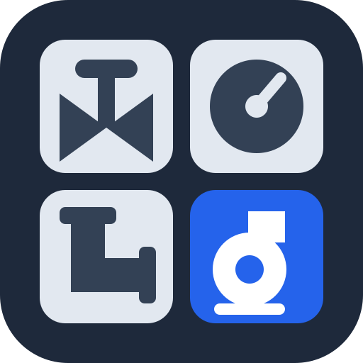
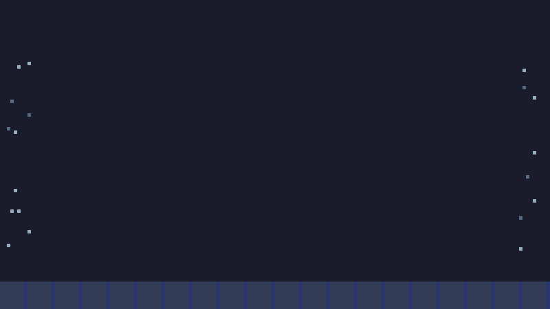
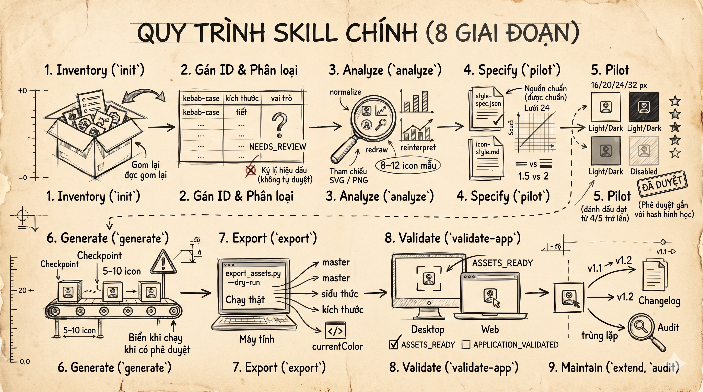

<p align="center">
  
</p>

<h1 align="center">Industrial Icon Designer</h1>

<p align="center">
  A Claude Code skill that redesigns icon sets for Desktop and Web apps into one consistent industrial/SCADA system.
</p>

<p align="center">
  <a href="https://code.claude.com/docs/en/skills"></a>
  
  
  <a href="https://github.com/linebender/resvg"></a>
  
  
  
  
  <a href="LICENSE"></a>
</p>

<p align="center">
  
</p>

---

SVG masters are the single source of truth; Desktop PNGs and Web SVGs are derived by scripts.
Tech stack: Python 3.11, [resvg](https://github.com/linebender/resvg) for rendering, Pillow, jsonschema,
defusedxml, pytest, and three pinned upstream skills from [shadcn-labs/skills](https://github.com/shadcn-labs/skills).

- Requirements: [`docs/SRS.md`](docs/SRS.md) (v2.1). Plan and milestone status: [`docs/implementation-plan.md`](docs/implementation-plan.md).
- Tested environment and dependency versions: [`docs/dependency-compatibility.md`](docs/dependency-compatibility.md).
- Worked example (synthetic): [`examples/scada-demo/`](examples/scada-demo/).
- The intro animation is built by [`examples/build_intro_gif.py`](examples/build_intro_gif.py) from the project's own masters, in the `pixel-arcade` style of the `ak:motion-video` catalog.

## What it does

<p align="center">
  
</p>

1. Inventories references (stable IDs, meaning, usage, sizes) without touching them.
2. Analyzes them, audits any SVG references, and records a redesign mode (`normalize`, `redraw`, `reinterpret`).
3. Keeps `style-spec.json` (authoritative) and `icon-style.md` (explanation) in sync.
4. Redraws an 8-12 icon pilot, previews it at 16/20/24/32 px, Light/Dark, normal/disabled, and waits for approval bound to file hashes.
5. Generates the rest in functional batches of 5-10 with checkpoints, then validates structure.
6. Exports transparent Desktop PNGs and inline Web SVGs (optionally resolved-color SVGs for ``), then inspects the exported files.
7. Records testing in real Desktop and Web contexts; without access the honest status is `ASSETS_READY`, never `APPLICATION_VALIDATED`.
8. Extends and versions the set with duplicate-meaning checks and invalidation of only what changed.

## See where you are

Ask for the `logs` skill (as a plugin: `/<plugin>:logs`) or run the script. It shows the eight steps as a vertical timeline, marks the step you are on (running, waiting for you, or stopped with the reason), shows the gate between steps and the next action, and never changes anything:

```bash
python3 skills/industrial-icon-designer/scripts/progress.py                 # newest set under ./icon-work
python3 skills/industrial-icon-designer/scripts/progress.py --set icon-work/<id> --format json
```

Colors are used on a terminal (`NO_COLOR` turns them off, `--color always|never` and `--ascii` override). For a permanent one-line view, point Claude Code's status line at the script in your own settings; it prints nothing in a project without a work set:

```json
{ "statusLine": { "type": "command",
  "command": "python3 /path/to/skills/industrial-icon-designer/scripts/progress.py --from-stdin --format line --color always" } }
```

A custom status line replaces most of the footer's key hints. Plugin users point `command` at the installed copy of `progress.py` under `~/.claude/plugins/`.

## Install as a Claude Code plugin

This repository is both a Claude Code marketplace and a plugin, so other people can install it without cloning:

```text
/plugin marketplace add quanap5/industrial-icon-designer
/plugin install industrial-icon-designer@quanap5-plugins
```

On Claude Code 2.1.275 or later one step also works: `/plugin install industrial-icon-designer --marketplace quanap5/industrial-icon-designer`.
The skill then runs as `/industrial-icon-designer:industrial-icon-designer`.

**The repository is private**, so each person needs two things and nothing else:

1. read access to the repository (invite them as a collaborator), and
2. one working git credential on their machine: an SSH key that does not prompt for a passphrase, **or** `gh auth login` followed by `gh auth setup-git`. On a machine without a GitHub SSH key also set `CLAUDE_CODE_PLUGIN_PREFER_HTTPS=1`.

Auto-update is off by default; people get new releases with `/plugin marketplace update quanap5-plugins`, and only when `version` in `.claude-plugin/plugin.json` changes. Remove it with `claude plugin uninstall industrial-icon-designer@quanap5-plugins`.

The plugin does not install Python or the renderer. After installing, do the one-time environment setup that `skills/industrial-icon-designer/SKILL.md` describes (a Python 3.11 environment under the plugin data directory, plus `resvg`), then run `doctor.py`. A plugin runs code with your user privileges, so read it before you install it.

## Setup from a checkout

Python 3.11+, the `resvg` renderer, and the Python packages in `requirements.lock`. On WSL2/Linux:

```bash
uv venv --python 3.11 env-py311 && uv pip install --python env-py311/bin/python -r requirements.lock
cargo install resvg                       # or a release binary from github.com/linebender/resvg
python skills/industrial-icon-designer/scripts/setup_upstream.py --clone /empty/dir \
    --dest .claude/skills --lock dependencies.lock.json     # explicit; verifies origin, writes the lock
ln -s ../../skills/industrial-icon-designer .claude/skills/industrial-icon-designer
python skills/industrial-icon-designer/scripts/doctor.py     # checks everything, installs nothing
```

`resvg` is a Rust CLI, not an npm package. The three upstream skills come from
`https://github.com/shadcn-labs/skills` and are pinned by commit and file hashes in
`dependencies.lock.json`; any difference blocks the affected phase instead of being substituted.
For personal use link or copy the skill to `~/.claude/skills/industrial-icon-designer/` instead.

## Use

In Claude Code, ask for the workflow or use the proposed conventions (they are not built-in commands):

```text
/industrial-icon-designer init refs=./references out=./icon-work/scada
/industrial-icon-designer analyze|pilot|generate|audit|export|validate-app|resume set=./icon-work/scada
/industrial-icon-designer extend set=./icon-work/scada icons=pump-stop,valve-open
```

When a decision is yours (what an unclear icon means, redesign mode, approving the pilot, how to resolve export conflicts, which application contexts you tested), the skill asks with multiple-choice questions instead of free text. Only your real answer is recorded as an approval; the full list is in [`references/questions.md`](skills/industrial-icon-designer/references/questions.md).

Scripts (in `skills/industrial-icon-designer/scripts/`, all take `--set DIR` and most take `--json`):

| Script | Purpose |
|---|---|
| `doctor.py` | Capability and dependency check; names blocked phases |
| `setup_upstream.py` | Explicit install of the locked upstream skills |
| `inventory_icons.py` | References to `inventory.json` |
| `analysis.py` | Brief, sample, baseline audit, analysis report |
| `style_spec.py` | Style spec, `icon-style.md` summary and consistency check |
| `render_preview.py` | Offline Before/After compare page (filter by group, Light/Dark, Normal/Disabled, size; `--group`) and Desktop, Web inline SVG and Web img context simulations |
| `approvals.py` | Hash-bound approvals with rubric scores |
| `batch.py` | Functional batches and checkpoints |
| `validate_icons.py` | Source QA (`--phase source`) and post-export QA (`--phase exported`) |
| `manifest.py` | Manifest sync, rejection, version bump and changelog |
| `invalidate.py` | Detect and apply invalidation |
| `export_assets.py` | Staged, journaled export; `--dry-run`, `--web-img`, `--resolve overwrite` |
| `app_validation.py` | Application-context records and honest status |
| `progress.py` | Read-only step timeline, one-line status form and JSON |
| `duplicate_check.py` | Duplicate-meaning check before adding an icon |

Exit codes: 0 success, 2 input/configuration, 3 dependency, 4 validation, 5 rendering/write failure.

## Tests

```bash
env-py311/bin/python -m pytest        # about 12 minutes; most time is process start-up
```

The suite covers acceptance tests AT-01 to AT-26 on synthetic fixtures and checks that every SRS
requirement is traceable. The full demo build (`examples/build_demo.py`) is itself test AT-26.

## Troubleshooting

- `resvg not found` (exit 3): install it as above; the renderer is the only one used for QA.
- `differ from the lock` (exit 3): an upstream file changed. Do not edit installed skills; rerun `setup_upstream.py` deliberately.
- `drift detected` on export (exit 4): a style, palette, renderer, size or geometry change is waiting. Run `invalidate.py detect --apply`, then export again.
- `conflicts found` on export (exit 4): files were edited by hand or are unknown. Nothing was changed. Review them, or rerun with `--resolve overwrite` (originals are kept in `exports/.conflicts/`).
- Interrupted export: just run it again; the recovery journal finishes the commit.

## Uninstall

Plugin install: `claude plugin uninstall industrial-icon-designer@quanap5-plugins`. Checkout: remove the `.claude/skills/industrial-icon-designer` symlink and `env-py311/`. Work sets under `icon-work/` and exported assets are yours and are not touched.

## Limitations

- Skill logic runs in Claude Code with an image-capable model; interpretation of PNGs and redrawing are model work and are not deterministic. Local validation, rendering and export are deterministic and offline.
- Reading images through Claude Code may send their content to the configured model service. Nothing is sent to other services.
- Only WSL2/Linux is tested. The demo set, fixtures and reviews are synthetic; the demo pilot review is an agent review, not human approval.
- No DevExpress 15.1.11 or Web application was available, so every actual application context is `not-tested`. Preview contexts are simulations.
- Tracing, ICO/ICNS, React components, icon fonts, brand/launcher icons and an MCP server are deferred (SRS 1.2).
- This workflow does not certify compliance with any industrial safety standard.

## License

Released under the [MIT License](LICENSE). Third-party components keep their own licenses; see
[`THIRD_PARTY_NOTICES.md`](THIRD_PARTY_NOTICES.md).
